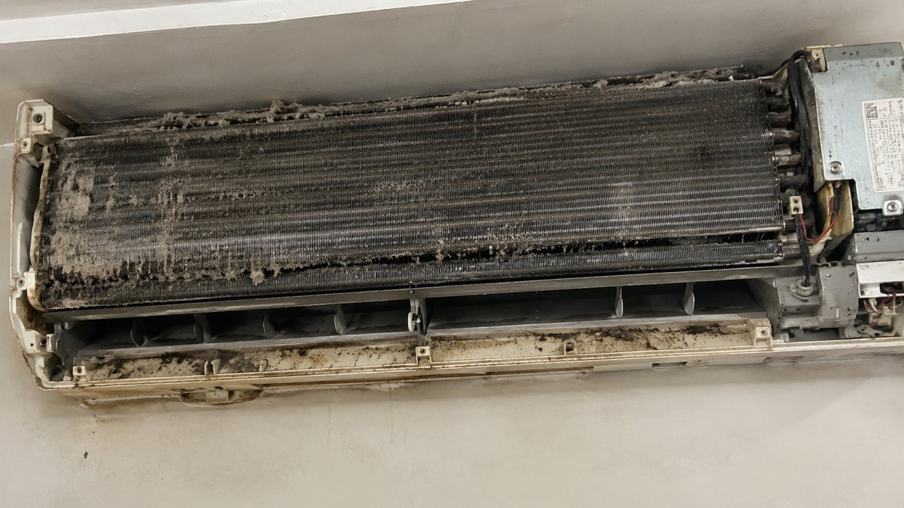

How often to service aircon in Singapore is one of the questions we hear most, usually right after someone notices water dripping onto their bed or a strange smell when the unit switches on. The honest answer depends on how hard your aircon works. In our hot and humid climate, most units work much harder than the same model would in a cooler country. Here is a simple guide from the technicians who clean these units every day.

## The short answer

As a rough guide for homes and offices in Singapore:

- **Every 3 months** for bedroom units that run every night, and for shops that keep the aircon on all day.
- **Every 4 to 6 months** for living room or guest room units used a few times a week.
- **Every 2 to 3 months** for offices, clinics and anywhere busy or dusty.
- **A chemical overhaul about once a year** for units used daily, or sooner if the unit smells or blows weak air.

If you cannot remember the last time your aircon was serviced, it is overdue. Book a [general aircon servicing](/aircon-servicing) first and let the technician tell you what condition the unit is in.

## Why aircon in Singapore needs more care

Aircon does two jobs at once. It cools the air and it pulls moisture out of it. In Singapore, the air is humid all year, so your unit removes a lot of water every day. That water runs over the cooling coil, into the drain tray and out through the drain pipe.

Dust from the room sticks to the wet coil. Over weeks, the dust and water turn into a layer of slime where mould grows. Add dust from nearby construction, cooking oil in the air and pet hair, and a unit that is not cleaned regularly clogs up quickly.

A clogged unit has to run longer to cool the same room. That means higher bills, more wear on the compressor and a shorter life for the whole system.

## Signs your aircon needs servicing now

Do not wait for the calendar if you see any of these:

- **Weaker airflow,** even with the fan on high.
- **Water dripping** from the indoor unit onto the wall or floor.
- **A musty or sour smell** for the first few minutes after you switch on.
- **Not as cold as before,** so you keep lowering the temperature.
- **New noises** like rattling, gurgling or a loud hum.
- **A higher electricity bill** with no change in how you use the aircon.

Most of these are early warnings. Caught now, a normal service usually fixes them. Ignored, they can turn into a leak, a frozen coil or a part that needs replacing.

## What happens during a general service

A proper general service is more than a quick wipe. At K2L Cool Aircon, a standard service covers:

1. Washing the air filters and cleaning the front panel.
2. Cleaning the fins and blower area we can reach without dismantling the unit.
3. Flushing and vacuuming the drain pipe so water does not back up and leak.
4. Checking the outdoor unit, including the fan, wiring and any sign of a gas leak.
5. Running the unit and testing the cold air and airflow before we leave.

Most homes take under an hour per unit. If the technician finds something that needs repair, you get a quote first. Nothing extra is done without your OK.

## When normal servicing is not enough

General servicing cleans the parts you can reach. Over time, dirt also builds up deep inside the unit, on the blower wheel and in the drain tray. Normal servicing cannot reach there.

If your unit still smells, drips or feels weak after a normal service, it probably needs a [chemical overhaul](/chemical-overhaul). The technician takes the unit apart, soaks and washes each part, rinses everything clean and puts it back together. For a unit used every day, once a year is usually enough, with general servicing every few months in between.

## What you can do between services

You do not need to be a technician to keep your aircon healthy. A few simple habits make a real difference:

- **Rinse the filters every two to four weeks.** Slide them out, rinse with water, let them dry fully and put them back.
- **Keep the temperature sensible.** Around 24 to 25°C is comfortable for most people and easier on the unit than 16°C.
- **Keep the outdoor unit clear.** Do not store boxes, plants or laundry racks around it. It needs space to release heat.
- **Close windows and doors** when the aircon is on, so it is not cooling the corridor.

HDB has a useful [home care guide for air-conditioners](https://www.hdb.gov.sg/managing-my-home/renovation-and-maintenance/home-maintenance/home-care-guide/air-conditioners) with more tips on daily care. If you are choosing a new unit, the [NEA energy label](https://www.nea.gov.sg/our-services/climate-change-energy-efficiency/energy-efficiency/household-sector/the-energy-label) shows how efficient each model is. More ticks means lower running costs.

## How much does aircon servicing cost?

At the time of writing, our general servicing starts from **$50 per unit**, and a chemical overhaul starts from **$120 per unit**. You can see every rate on our [aircon price list](/pricing).

Regular servicing usually pays for itself. A clean unit cools faster and runs fewer hours to reach the same temperature. With electricity rates you can check on the [SP Group tariff page](https://www.spgroup.com.sg/our-services/utilities/tariff-information), even a small drop in running time each night adds up over a year.

## Our honest advice

Set a reminder on your phone. Every three months for the rooms you use every night, every four to six months for the rest. If your unit shows any of the warning signs above, do not wait for the reminder.

Not sure what your aircon needs? WhatsApp us a short video of the unit running and tell us when it was last cleaned. We will tell you honestly whether a normal service is enough, and we will always give you the price before we start.
