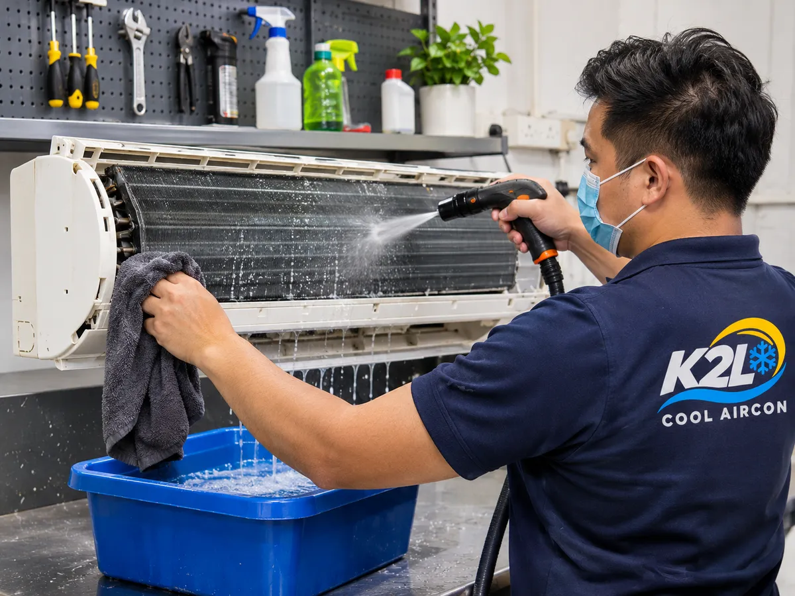
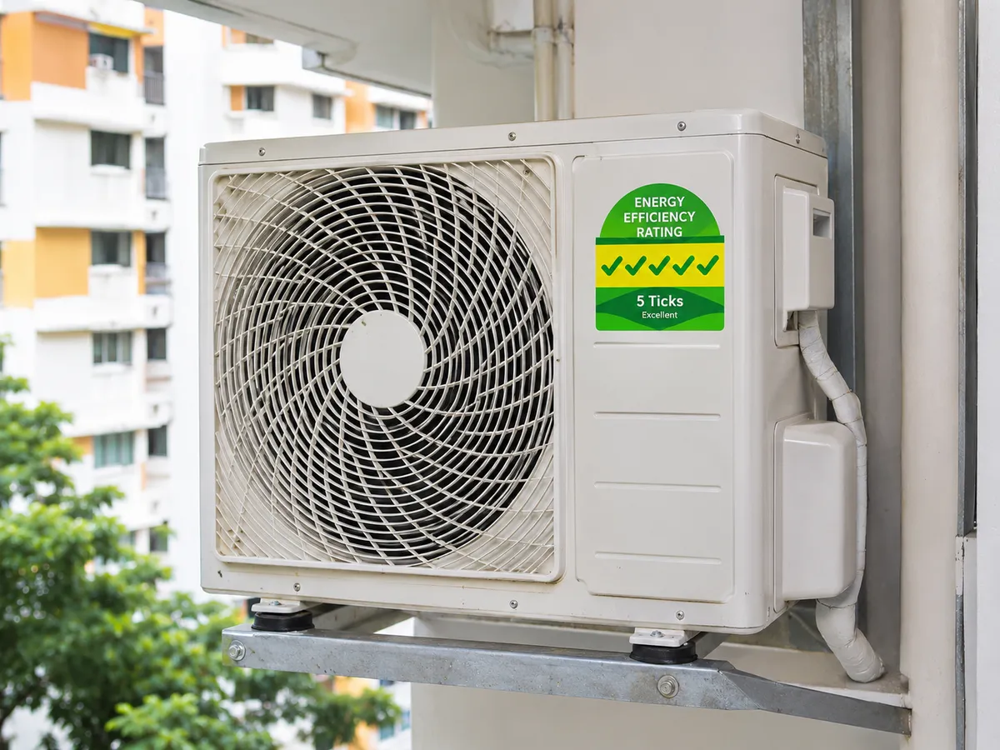

Choosing between a used aircon vs new aircon is one of the first decisions you face when you move into an HDB flat, replace a unit that has finally given up, or fit out a rental room. Both options can keep you cool through Singapore's heat. The right choice depends on your budget, how long you plan to stay, and how much you care about your monthly electricity bill. Here is a straight comparison from the technicians who install both every week.

## Used aircon vs new aircon: the price gap

Price is the main reason people look at second hand aircon in Singapore. At the time of writing, our second-hand aircon starts from **$700, installed**, while a brand new aircon starts from **$1,350, supplied and installed**. You can see the full breakdown on our [aircon prices page](/pricing).

That gap gets bigger when you need more than one unit. For a three-room HDB flat with a living room and two bedrooms, going second-hand can save you enough to cover a year or more of servicing.

## What you get with a new aircon

A brand new aircon comes straight from the manufacturer with no history. The main advantages:

- **Full manufacturer warranty.** Most brands cover the compressor for several years, which is the most expensive part to replace.
- **Latest technology.** Newer inverter models adjust their speed instead of switching on and off, which keeps the room temperature steady.
- **Higher energy ratings.** New models are more likely to carry a high tick rating on the energy label.
- **Your choice of model.** You pick the brand, size and style that suits your room, instead of choosing from what is in stock.

Singapore's [energy label from NEA](https://www.nea.gov.sg/our-services/climate-change-energy-efficiency/energy-efficiency/household-sector/the-energy-label) rates air conditioners from 1 tick (low) to 5 ticks (excellent). For split units, the label is stuck on the outdoor unit, so check it there when you compare models. If you want to go new, our [new aircon installation](/aircon-installation) page covers the brands we supply and how installation works.

## Buying a used aircon in Singapore: what you get

The words "second-hand" make some people nervous, and with good reason. A used unit bought from a stranger online can arrive dirty, low on gas, or close to failing. That is a gamble.

If you want to buy a used aircon in Singapore, buy from a proper aircon company instead. Every [second-hand aircon](/second-hand-aircon) we sell is:

- **Chemically washed** inside and out, so you are not breathing in someone else's dust and mould.
- **Tested before it leaves us,** so we know it cools properly and runs quietly.
- **Installed by our own technicians,** with the installation already included in the price.
- **Covered by warranty,** so if something goes wrong, we come back and sort it out.

Many of our units come from homes that upgraded or moved out, not from units that broke down.

## Running costs: where new units can win

The purchase price is only part of the cost. An aircon in Singapore can run many hours a day, so electricity adds up.

Newer models must meet NEA's [minimum energy performance standards](https://www.nea.gov.sg/our-services/climate-change-energy-efficiency/energy-efficiency/household-sector/minimum-energy-performance-standards), and the most efficient ones carry 4 or 5 ticks. An older unit with fewer ticks will usually use more power to cool the same room. If you run your aircon all night, every night, a more efficient unit can save you a noticeable amount each year.

How much you save depends on the electricity price, how many hours you use it, and the room size. You can check the current household rate on the [SP Group tariff page](https://www.spgroup.com.sg/our-services/utilities/tariff-information) and compare it with how often you actually switch on.

For a room used a few hours a week, the difference is small. For a master bedroom that runs eight hours every night, efficiency matters much more.

## How long each option lasts

A new aircon that is serviced regularly can give you many years of reliable cooling. A second-hand unit has already used some of that life, so you should expect fewer years from it.

The biggest factor is not new or used. It is maintenance. A unit that is cleaned every few months and has its gas checked will usually outlast a neglected one, whether it was bought new or second-hand. Dirty filters and blocked coils make any aircon work harder and wear out sooner.

## Which one suits your home?

**Choose a second-hand aircon if:**

- You want to keep upfront costs low, especially for several rooms.
- You are renting, or you plan to move within a few years.
- The aircon is for a room that is not used every day.
- You want a working unit installed quickly without a big spend.

**Choose a new aircon if:**

- You plan to stay in your home for many years.
- The aircon will run long hours every day, such as in a master bedroom.
- You want the highest energy rating to keep bills down.
- You want a specific brand, model or system for a renovation.

Many of our customers mix both. They put a new, efficient unit in the bedroom that runs every night, and a good second-hand unit in the study or spare room.

## Our honest advice

There is no single right answer in the used aircon vs new aircon question. A good second-hand aircon in Singapore saves money upfront, while a new unit saves more over time.

Tell us about your rooms, how often you use the aircon and your budget, and we will recommend the option that makes sense for you, even if it is the cheaper one. Send us a message through our [contact page](/contact) and we will give you the price first, before any work starts.
