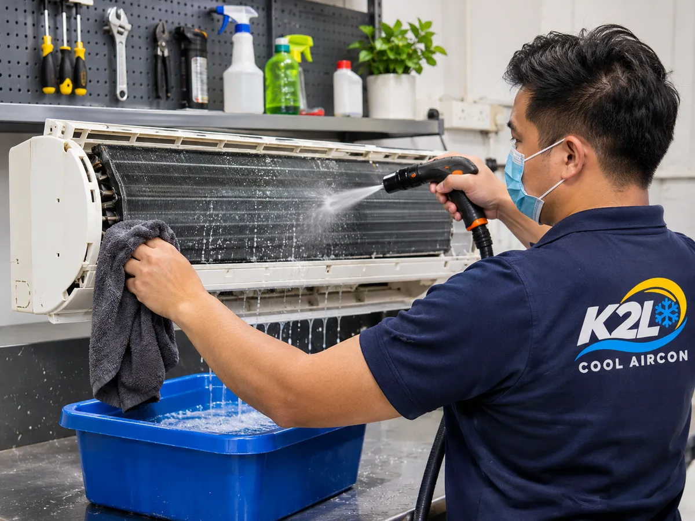
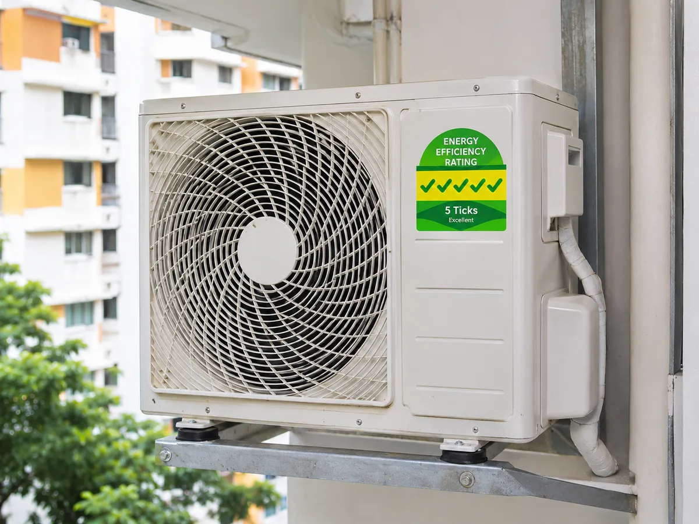

二手冷气还是全新冷气？这是很多人搬进组屋、旧冷气终于坏掉，或者要给出租房间装冷气时，第一个要做的决定。两种选择都能让您在新加坡的炎热天气里保持凉爽。哪一种更适合您，要看预算、打算住多久，以及您有多在意每个月的电费。以下是每周都在安装这两种冷气的技术人员，给您的直接比较。

## 二手冷气和全新冷气：价格差多少

价格是大家考虑新加坡二手冷气的主要原因。在撰写本文时，我们的二手冷气**$700起，含安装**，而全新冷气**$1,350起，含供应和安装**。完整价格可以在我们的[冷气价格表](/zh/pricing)查看。

需要不止一台的时候，差距会更大。以三房式组屋为例，客厅加两个卧室，选择二手冷气省下的钱，可能足够支付一年以上的保养费用。

## 买全新冷气，您得到什么

全新冷气直接来自厂家，没有任何使用记录。主要好处：

- **完整的原厂保修。** 大部分品牌对压缩机提供多年保修，而压缩机是最贵的零件。
- **最新技术。** 较新的变频机型会调节转速，而不是一直开开关关，室温更稳定。
- **能效等级更高。** 新机型更有可能在能源标签上拿到较高的勾数。
- **自己选型号。** 品牌、大小和款式都由您挑，而不是从现有库存里选。

新加坡[NEA的能源标签](https://www.nea.gov.sg/our-services/climate-change-energy-efficiency/energy-efficiency/household-sector/the-energy-label)将冷气从1个勾（低）到5个勾（优秀）分级。分体式冷气的标签贴在室外机上，比较型号时记得看那里。如果想买新的，我们的[全新冷气安装](/zh/aircon-installation)页面介绍了我们供应的品牌和安装流程。

## 在新加坡买二手冷气：您得到什么

"二手"两个字让一些人担心，这很正常。在网上跟陌生人买的二手机，可能很脏、雪种不足，或者快要坏了。那是在赌运气。

如果想在新加坡买二手冷气，请找正规的冷气公司。我们卖的每台[二手冷气](/zh/second-hand-aircon)都：

- **经过化学清洗**，里外都洗干净，您不会吸到别人家的灰尘和霉菌。
- **出门前经过测试**，确认制冷正常、运转安静。
- **由我们自己的技术人员安装**，安装费已包含在价格里。
- **附带保修**，如果出问题，我们回来处理。

我们很多二手机来自升级或搬家的住户，而不是坏掉的机器。

## 电费：新机可能更胜一筹

购买价格只是成本的一部分。在新加坡，冷气一天可能开很多个小时，电费会累积起来。

新机型必须符合NEA的[最低能效标准](https://www.nea.gov.sg/our-services/climate-change-energy-efficiency/energy-efficiency/household-sector/minimum-energy-performance-standards)，最省电的机型有4到5个勾。勾数较少的旧机，冷却同一个房间通常更耗电。如果您每晚整夜开冷气，一台更省电的机器每年能省下可观的电费。

能省多少，要看电价、使用时数和房间大小。您可以在[SP Group电价页面](https://www.spgroup.com.sg/our-services/utilities/tariff-information)查看目前的住家电价，再对照自己实际开冷气的频率。

如果房间每周只用几个小时，差别不大。如果是每晚开八小时的主人房，能效就重要得多。

## 两种选择能用多久

定期保养的全新冷气，可以稳定使用很多年。二手冷气已经用掉一部分寿命，所以预期使用年数会少一些。

最大的影响因素其实不是新或旧，而是保养。每几个月清洗一次、定期检查雪种的冷气，通常比没人管的冷气用得更久，不管是新买还是二手。过滤网脏、冷凝器堵塞，会让任何冷气都更辛苦、更快损坏。

## 哪一种适合您家？

**以下情况选二手冷气：**

- 想降低前期花费，尤其是要装好几个房间。
- 您是租客，或打算几年内搬家。
- 冷气装在不是每天用的房间。
- 想快速装好一台能用的冷气，不想花大钱。

**以下情况选全新冷气：**

- 打算在家里住很多年。
- 冷气每天要开很长时间，例如主人房。
- 想要最高能效等级，降低电费。
- 装修时想要特定的品牌、型号或系统。

很多客户两种都选。他们在每晚都开的卧室装一台省电的新机，在书房或客房装一台好的二手机。

## 我们的诚实建议

二手冷气还是全新冷气，没有唯一正确的答案。好的二手冷气在新加坡能省下前期费用，而全新冷气长期下来更省电。

告诉我们您的房间情况、开冷气的频率和预算，我们会推荐真正适合您的选择，即使是比较便宜的那一个。通过[联系我们](/zh/contact)页面发信息给我们，开工前我们一定先报价。
