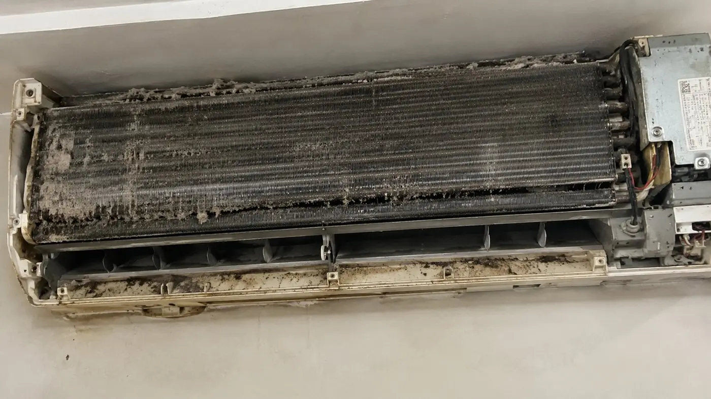

在新加坡，冷气多久保养一次？这是我们最常被问到的问题之一，通常是有人发现冷气滴水到床上，或一开机就有怪味之后。诚实的答案是：要看您的冷气工作得多辛苦。在我们炎热潮湿的气候里，大部分冷气比同款机器在凉爽国家辛苦得多。以下是每天清洗冷气的技术人员给您的简单指南。

## 简单答案

新加坡住家和办公室的大概参考：

- **每3个月一次**：每晚都开的卧室冷气，以及整天开冷气的店铺。
- **每4到6个月一次**：每周只开几次的客厅或客房冷气。
- **每2到3个月一次**：办公室、诊所，以及人多或灰尘多的地方。
- **大约每年一次化学清洗**：每天用的冷气，如果有异味或风变弱，要更早做。

如果您记不起上次保养是什么时候，那就已经过期了。先预约一次[普通冷气保养](/zh/aircon-servicing)，让技术人员告诉您机器目前的状况。

## 为什么新加坡的冷气更需要照顾

冷气同时做两件事：降温，以及把空气里的水分抽出来。新加坡全年潮湿，所以冷气每天要排出很多水。这些水流过蒸发器，进入排水盘，再从排水管流出去。

房间里的灰尘会黏在湿的蒸发器上。几个星期后，灰尘和水会变成一层黏液，霉菌就在那里生长。再加上附近工地的灰尘、煮饭的油烟和宠物毛，不定期清洗的冷气很快就会堵塞。

堵塞的冷气要运转更久才能把同一个房间降温。这意味着电费更高、压缩机磨损更多，整台机器的寿命也更短。

## 冷气需要马上保养的迹象

看到以下任何一个，不要等日历：

- **风变弱**，即使风速开到最大。
- **室内机滴水**到墙上或地上。
- **一开机的头几分钟有霉味或酸味。**
- **没以前那么冷**，所以您一直调低温度。
- **出现新的声音**，例如咔咔声、咕噜声或很大的嗡嗡声。
- **电费变高**，但您用冷气的习惯没变。

这些大多是早期警告。现在处理，普通保养通常就能解决。不理它，可能会变成漏水、蒸发器结冰，或需要换零件。

## 普通保养做什么

正规的普通保养不只是随便擦一擦。在K2L Cool Aircon，标准保养包括：

1. 清洗过滤网，擦干净前盖。
2. 清洁不拆机就能清到的散热片和风轮部分。
3. 冲洗并吸通排水管，避免积水漏出来。
4. 检查室外机，包括风扇、电线，以及有没有漏雪种的迹象。
5. 开机测试冷风和风量，确认正常才离开。

大部分住家每台不到一小时。如果技术人员发现需要维修的地方，会先给您报价。没有您同意，不会多做任何事。

## 普通保养不够的时候

普通保养清洁的是能直接清到的部分。时间久了，污垢也会积在机器深处，例如风轮和排水盘上。普通保养清不到那里。

如果普通保养后冷气还是有异味、滴水或风弱，很可能需要做[化学清洗](/zh/chemical-overhaul)。技术人员会把机器拆开，每个零件浸泡清洗，冲洗干净后再装回去。每天用的冷气通常一年做一次就够，中间每几个月做一次普通保养。

## 两次保养之间您可以做什么

不需要是技术人员，也能让冷气保持健康。几个简单习惯很有帮助：

- **每两到四周冲洗过滤网。** 抽出来用水冲，完全晾干再装回去。
- **温度设定合理。** 24到25°C对大部分人来说很舒服，也比16°C更不伤机器。
- **保持室外机周围畅通。** 不要在旁边堆箱子、盆栽或晾衣架，它需要空间散热。
- **开冷气时关好门窗**，不要让冷气去冷走廊。

建屋发展局有一份实用的[冷气居家保养指南](https://www.hdb.gov.sg/managing-my-home/renovation-and-maintenance/home-maintenance/home-care-guide/air-conditioners)，提供更多日常保养建议。如果您要选新冷气，[NEA能源标签](https://www.nea.gov.sg/our-services/climate-change-energy-efficiency/energy-efficiency/household-sector/the-energy-label)会显示每个型号的能效，勾越多，运行成本越低。

## 冷气保养要多少钱？

在撰写本文时，我们的普通保养**每台$50起**，化学清洗**每台$120起**。所有价格都在我们的[冷气价格表](/zh/pricing)上。

定期保养通常能回本。干净的冷气降温更快，达到同样温度所需的运转时间更短。电价可以在[SP Group电价页面](https://www.spgroup.com.sg/our-services/utilities/tariff-information)查看，即使每晚只少运转一点点，一年下来也很可观。

## 我们的诚实建议

在手机上设个提醒。每晚都用的房间每三个月一次，其他房间每四到六个月一次。如果冷气出现上面任何警告迹象，不要等提醒。

不确定冷气需要什么？WhatsApp我们一段冷气运转的短视频，告诉我们上次清洗是什么时候。我们会诚实告诉您普通保养够不够，而且开工前一定先报价。
